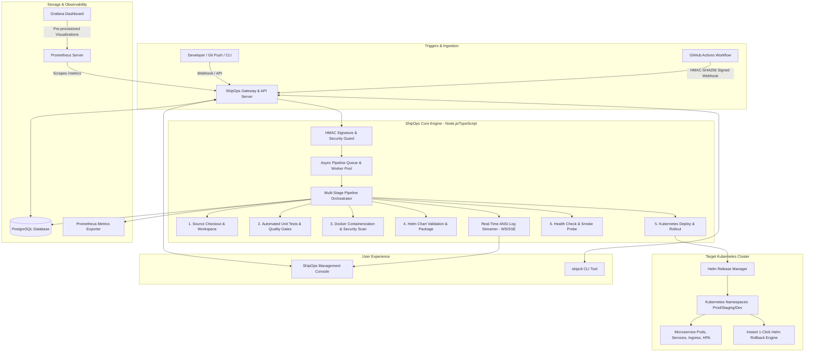

# 🚀 ShipOps — Cloud-Native CI/CD Deployment Engine & K8s Orchestrator

[](https://github.com/AnujBehra/cloud-native-cicd-platform/actions)
[](tsconfig.json)
[-326CE5.svg?logo=kubernetes&logoColor=white)](k8s)
[](charts)
[](Dockerfile)
[](monitoring)
[](monitoring)
[](src/db)

> **Resume Project:**
> **ShipOps — Cloud-Native CI/CD Deployment Engine & K8s Orchestrator** | *Node.js, TypeScript, Docker, Kubernetes, Helm, PostgreSQL, Prometheus*  
> • Engineered automated 6-stage CI/CD engine executing source validation, unit tests, multi-stage Docker builds, Trivy CVE security scans, and Helm packaging upon HMAC webhooks.  
> • Implemented zero-downtime K8s rolling updates (`maxSurge=25%`, `maxUnavailable=0`) and an instant 1-click Helm rollback engine tracking complete revision history in PostgreSQL.  
> • Built real-time ANSI log streaming over WebSocket and SSE, delivering sub-second live pipeline execution feedback to an interactive web management console and `shipctl` CLI.  
> • Instrumented native Prometheus metrics and designed pre-provisioned Grafana dashboards tracking the 4 core DORA metrics (Deployment Frequency, Lead Time, Change Failure Rate, MTTR).

---

## 📌 Architecture Overview



---

## ✨ Key Features & Technical Capabilities

1. **Multi-Stage Automated Pipeline Engine**:
   - **Checkout**: Clones and isolates workspace per commit SHA.
   - **Automated Tests**: Executes full test suites with coverage thresholds and assertion reporting.
   - **Containerization**: Multi-stage Docker builds, image digest calculation (`sha256`), vulnerability scans (Trivy style), and registry publishing.
   - **Helm Lint & Packaging**: Validates OpenAPI schemas, renders template dry-runs, and produces `.tgz` versioned chart archives.
   - **Kubernetes Rolling Update**: Manages zero-downtime rolling upgrades (`maxSurge=25%`, `maxUnavailable=0`) and monitors pod readiness.
   - **Post-Deploy Probes**: Automated verification of `/healthz`, `/ready`, and `/metrics` endpoints.

2. **Instant 1-Click Helm Rollback**:
   - Stores full revision history, previous image tags, and values overrides in PostgreSQL.
   - 1-Click rollback creates a new active revision pointing to the desired target release and syncs Kubernetes workloads seamlessly.

3. **Enterprise Observability & DORA Metrics**:
   - Exposes native Prometheus metrics at `/metrics` (`cicd_pipeline_runs_total`, `cicd_stage_duration_seconds`, `k8s_active_replicas`, `cicd_rollbacks_total`).
   - Automatically computes 4 core **DORA Metrics**: *Deployment Frequency*, *Lead Time for Changes*, *Change Failure Rate*, and *Mean Time to Restore (MTTR)*.
   - Ships with pre-provisioned Grafana dashboard JSON (`monitoring/grafana/dashboards/cicd-platform.json`).

4. **Real-Time Streaming Terminal**:
   - Streams colored ANSI logs over WebSocket and Server-Sent Events (SSE) directly to the web dashboard.
   - Historical log playback and zero-latency terminal auto-scrolling.

5. **Flexible Execution Target**:
   - **Live Cluster Mode**: Direct connection to live Kubernetes clusters (`minikube`, `kind`, `k3d`, EKS, GKE) via `@kubernetes/client-node`.
   - **Standalone Mode**: Built-in high-fidelity stateful cluster simulator for zero-setup local demonstrations and automated CI test runs.

---

## 🛠️ Tech Stack

| Component | Technology | Purpose |
| :--- | :--- | :--- |
| **Backend & Engine** | Node.js, TypeScript, Express, WebSockets | Core API gateway, async pipeline orchestrator, log streamer |
| **Database** | PostgreSQL 16, pg | Relational storage for projects, pipeline runs, stages, deployments, and Helm history |
| **Containerization** | Docker, Multi-Stage Builds | Application containerization, image tagging, and registry management |
| **Orchestration** | Kubernetes (`@kubernetes/client-node`) | Pod management, rolling updates, health checks, service discovery |
| **Package Management**| Helm v3 | Kubernetes templating, release lifecycle management, and instant rollbacks |
| **Observability** | Prometheus (`prom-client`), Grafana | Custom metrics instrumentation, scrape endpoints, and DORA dashboards |
| **CI/CD Automation** | GitHub Actions | Platform CI workflows and HMAC webhook integration |
| **Frontend Console** | HTML5, Tailwind CSS, Vanilla JS, SSE | Real-time DevOps dashboard, DAG stepper, and terminal log viewer |
| **CLI** | `shipctl` | Command-line management tool |

---

## 🚀 Quickstart Guide

### Option 1: Run with Docker Compose (Full Production Stack)

Bring up ShipOps Platform, PostgreSQL, Prometheus, and Grafana in a single command:

```bash
docker-compose up -d
```

- 🖥️ **ShipOps Web Console**: [http://localhost:4000](http://localhost:4000)
- 📊 **Prometheus Scrape / Web**: [http://localhost:9090](http://localhost:9090)
- 📈 **Grafana DORA Dashboards**: [http://localhost:3001](http://localhost:3001) (Credentials: `admin`/`admin` or anonymous viewer)
- 📡 **Metrics Endpoint**: [http://localhost:4000/metrics](http://localhost:4000/metrics)

---

### Option 2: Local Development Mode

```bash
# 1. Install dependencies
npm install

# 2. Build TypeScript
npm run build

# 3. Start development server with live reload
npm run dev

# 4. Run test suites
npm test
```

---

## 💻 `shipctl` CLI Usage

ShipOps includes a native CLI utility (`shipctl`):

```bash
# List registered projects
npm run shipctl projects list

# Trigger a pipeline run and deploy to production
npm run shipctl pipeline run order-service production

# Stream pipeline logs
npm run shipctl pipeline logs <run-id>

# View recent pipeline runs
npm run shipctl pipeline list

# List active deployments
npm run shipctl deployments list

# Perform 1-click Helm rollback
npm run shipctl rollback order-service-prod 1

# Inspect Kubernetes pods
npm run shipctl k8s pods production

# View DORA metrics report
npm run shipctl metrics dora
```

---

## 📡 REST API Reference

| Method | Endpoint | Description |
| :--- | :--- | :--- |
| `GET` | `/healthz` | Platform health check |
| `GET` | `/api/projects` | List all registered repositories and configurations |
| `POST` | `/api/pipelines/trigger` | Queue a new pipeline build and deployment |
| `GET` | `/api/pipelines` | List pipeline executions with status and duration |
| `GET` | `/api/pipelines/:id` | Get detailed pipeline run with stage statuses |
| `GET` | `/api/pipelines/:id/logs` | Fetch buffered logs for a pipeline |
| `GET` | `/api/pipelines/:id/stream` | **Server-Sent Events (SSE)** real-time log stream |
| `GET` | `/api/deployments` | List deployments filtered by environment |
| `POST` | `/api/deployments/rollback` | Execute instant Helm release rollback |
| `GET` | `/api/k8s/pods` | Inspect active Kubernetes pods |
| `GET` | `/api/metrics/dora` | Get real-time computed DORA metrics |
| `GET` | `/metrics` | Prometheus metrics scrape endpoint |
| `POST` | `/api/webhooks/github` | Ingest GitHub `push` & `pull_request` webhooks |
| `POST` | `/api/simulator/push` | Simulate a GitHub push to trigger automatic release |

---

## 🔒 GitHub Webhook Integration

Configure a webhook in your GitHub repository:
- **Payload URL**: `http://<your-host>:4000/api/webhooks/github`
- **Content type**: `application/json`
- **Secret**: `shipops-secret-token-12345`
- **Events**: `Pushes` and `Pull requests`

ShipOps automatically verifies the `X-Hub-Signature-256` HMAC signature, checks out the code, executes the test suite, containerizes the app, and triggers a rolling Helm deployment to Kubernetes.

---

## 📄 License
Apache-2.0. Built for production cloud-native engineering.
